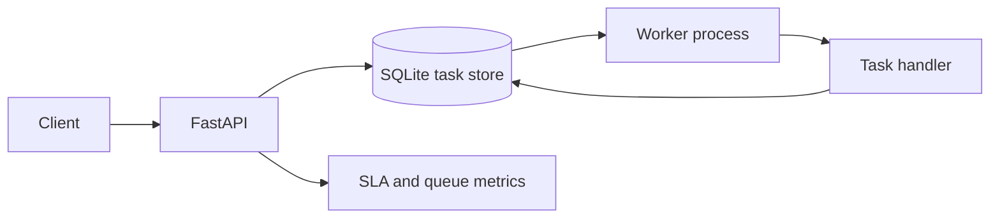

# TaskFlow — Workflow Automation API

A portfolio project demonstrating Python REST APIs, priority-based task scheduling, worker execution, retries, failure handling, SLA tracking, and automated tests.

## Stack
Python 3.11+, FastAPI, SQLAlchemy, SQLite, pytest.

## Run locally
```bash
python -m venv .venv
# Windows: .venv\Scripts\activate
# macOS/Linux: source .venv/bin/activate
pip install -r requirements.txt
uvicorn app.main:app --reload
```
Open http://127.0.0.1:8000/docs.

In a second terminal, run the worker:
```bash
python -m app.worker
```

## Example
```bash
curl -X POST http://127.0.0.1:8000/tasks -H "Content-Type: application/json" -d "{\"task_type\":\"uppercase\",\"payload\":{\"text\":\"hello\"},\"priority\":5}"
curl -X POST http://127.0.0.1:8000/worker/run-once
curl http://127.0.0.1:8000/metrics/summary
```

Supported types: `uppercase`, `echo`, and `simulate_failure` (for retry demonstrations).

## Architecture


## Important scope note
SQLite is used to make local setup simple. For production-scale concurrent workers, consider PostgreSQL plus Redis/RabbitMQ, task claiming/locking, authentication, structured logging, metrics, and deployment controls.

## Resume bullet
After you run and verify it, you can describe it as: “Built a Python/FastAPI workflow automation service with priority-based task scheduling, worker execution, retry policies, and SLA deadline tracking, supported by automated tests.”
